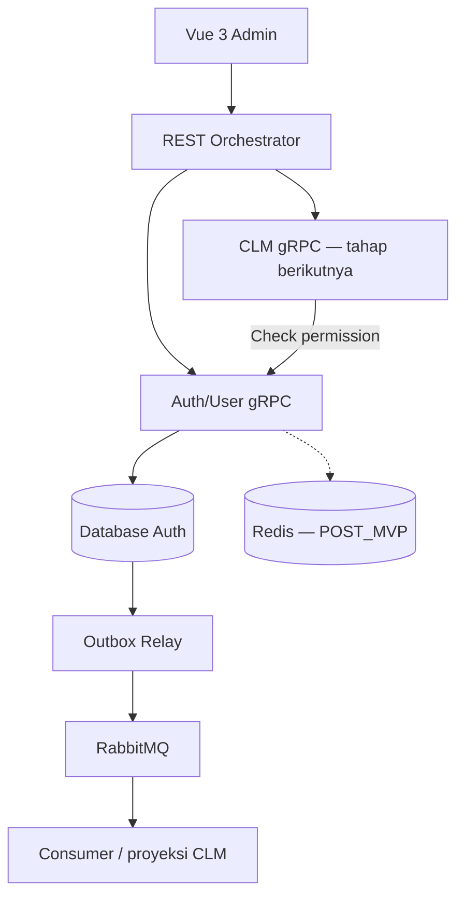

# Spesifikasi User Management System

Versi: 1.2\
Tanggal: 8 Oktober 2026\
Tanggal revisi: 9 Oktober 2026\
Project: `[PRACTICE] MINI-PROJECT`\
Target: pengembangan auth service yang sudah mencakup user service; integrasi dengan Contract Lifecycle Management (CLM) sebagai service terpisah.

Acuan implementasi repository: [Spesifikasi MVP grpc-auth](grpc-auth-mvp-spec.md). Dokumen ini mencakup seluruh sistem; batas MVP service, inventaris full RPC, keputusan token/locking, dan verification gates mengikuti spec MVP tersebut. Rencana [grpc-auth-mvp-spec-plan.md](grpc-auth-mvp-spec-plan.md) menjadi asal penyusunan, bukan bukti implementasi.

## 1. Tujuan dan kondisi awal

Auth service existing (`grpc-auth`) memiliki register, login, `Me`, update profil, dan list/search user. Relasi banyak role per user sudah tersedia melalui `user_role`. Pengembangan ini melengkapi pengelolaan user, role, permission, akses aplikasi, sesi login persisten, serta audit trail.

User management tetap berada di auth service yang ada. CLM nantinya menggunakan identitas dan keputusan permission dari auth service melalui gRPC, tanpa mengakses database auth secara langsung.

Dokumen ini memuat target perilaku dan keputusan schema setelah inspeksi codebase serta DDL existing. User telah melaporkan pelaksanaan migration/seed dan menetapkan `auth.password` sebagai `VARCHAR(150)`. Laporan tersebut belum menjadi verifikasi database langsung atau bukti bahwa seluruh behavior aplikasi telah diterapkan. Nama tabel dan tipe ID di bagian 6 mengikuti schema yang disepakati; kontrak, JWT, route, wiring, dan pengujian masih harus diselaraskan dengan implementasi.

### 1.1 Keputusan awal

| Topik | Keputusan untuk versi awal |
| --- | --- |
| Model akses | RBAC: user → banyak role → banyak permission |
| Tenant | Satu organisasi; multi-tenant ditunda |
| Role hierarchy | Tidak ada inheritance/nested role |
| Direct permission ke user | Tidak didukung; permission berasal dari role |
| Explicit deny per permission | Tidak didukung; pencabutan dilakukan melalui role atau akses aplikasi |
| Sumber kebenaran akses | Database auth service |
| Permission catalog | Didefinisikan dalam spec, disinkronkan melalui migration/seed |
| Custom role | Bisa dibuat admin menggunakan permission yang sudah terdaftar |
| Identitas | Pertahankan ID numerik immutable existing; ID baru session/token/event memakai UUID |
| Database auth | PostgreSQL existing; tabel identitas/credential tetap `auth`, profil tetap `profile` |
| Email | Kolom `auth.email` sudah dinormalisasi; tidak menambah kolom email terpisah |
| Password hash | Argon2id existing, disimpan di `auth.password VARCHAR(150)` |
| Timezone | Session SQL memakai `Asia/Jakarta`; timestamp baru memakai `TIMESTAMPTZ` |
| Oracle | Dapat digunakan oleh service domain lain; tidak diwajibkan untuk auth |
| Pencabutan akses | Berlaku pada evaluasi otorisasi baru setelah transaksi revoke commit |
| Event | RabbitMQ untuk perubahan identitas/akses dan integrasi asynchronous |
| Token | Token identitas + sesi; role di JWT tidak menjadi sumber izin |
| Penghapusan user | Deactivation melalui `auth.status`; mempertahankan data dan histori |

### 1.2 Ruang lingkup

**Wajib:** pengelolaan user, multi-role, role-permission mapping, grant/revoke role, grant/revoke akses aplikasi, suspend/reactivate/deactivate user, logout/revoke session, audit, outbox, otorisasi server-side, dan UI admin.

Untuk MVP repository `grpc-auth`, UI/REST merupakan pekerjaan repository lain; relay RabbitMQ, consumer, integrasi CLM, Redis/distributed limiter, dan eksperimen multi-replica merupakan POST_MVP. MVP tetap menulis audit dan required outbox secara atomik sejak mutasi pertama. Limiter awal memakai token bucket in-memory untuk satu instance lokal. DeleteRole, reset password admin/publik, dan CRUD definisi permission/aplikasi ditunda; catalog read, custom-role metadata/status, dan replace permission mapping tetap wajib.

**Lanjutan:** invite user melalui email, forgot/reset password, MFA, SSO, role dengan expiry, multi-tenant, approval grant akses, groups/departments, dan policy engine generik. Fitur tersebut tidak menjadi syarat MVP; jangan membuat endpoint placeholder yang terlihat berfungsi.

### 1.3 Kondisi implementasi setelah penyesuaian database

| Bagian | Kondisi |
| --- | --- |
| Register/login, Me, update profil, list/search | Sudah ada pada code existing |
| Banyak role per user | Relasi dan pembacaan existing tersedia; command grant/revoke belum terbukti diterapkan |
| Migration/backfill dan seed IAM | Dilaporkan telah dijalankan user; hasil schema/index dan jumlah admin aktif belum diverifikasi langsung |
| Password column | User menetapkan `VARCHAR(150)`; hash existing dipertahankan |
| REST list user | Existing memakai role admin numerik 2; target memakai `iam.user.read` |
| gRPC protected method | Existing memvalidasi JWT; target memerlukan status user, sesi, dan permission authoritative |
| Session-aware auth, refresh/logout, mutasi akses | Target implementasi; keberadaan tabel/seed belum membuktikan behavior berjalan |
| Relay RabbitMQ, UI admin, CLM | Target implementasi; seed role CLM dan schema consumer opsional belum dikonfirmasi dijalankan |

Jangan menandai tahap aplikasi selesai hanya karena DDL atau seed berhasil. Verifikasi database dan acceptance criteria behavior tetap diperlukan.

## 2. Batas tanggung jawab dan arsitektur

| Komponen | Tanggung jawab |
| --- | --- |
| Vue 3 + Vite | Login, profil, admin users/roles, tampilan permission dan sesi |
| Go REST Orchestrator | API browser, validasi payload, penerjemahan REST → gRPC, response aggregation |
| Auth/User gRPC Service | Credential, identitas, role, permission, app access, session, keputusan akses dan audit |
| Database auth | Seluruh data authoritative auth, audit dan transactional outbox |
| Outbox relay | Mengirim event committed ke RabbitMQ |
| Redis (POST_MVP grpc-auth) | Distributed rate limiting dan cache non-authoritative; limiter MVP memakai memory lokal |
| CLM gRPC Service (nanti) | Kontrak, workflow, reviewer, approval, resource authorization |
| Elasticsearch + Kibana | Pencarian log berkorelasi; tracing UI memerlukan instrumentasi/Elastic APM jika ditambahkan |



REST orchestrator tidak menyimpan role atau menulis database auth. Auth gRPC tetap memverifikasi caller dan permission, termasuk bila endpoint dipanggil tanpa melalui REST. CLM juga memeriksa permission untuk aksi yang diterimanya, lalu memeriksa aturan kontrak.

Pisahkan identitas pengguna dari identitas service. JWT pengguna membuktikan pengguna yang memulai request; service token opaque per caller melalui TLS membuktikan service yang memanggil gRPC pada MVP. Server memverifikasi digest credential, service ID, expiry, serta allowlist RPC/namespace dari konfigurasi server. Metadata `x-service-token` terpisah dari `authorization: Bearer <JWT>` dan tidak berasal dari input browser. Seluruh RPC, termasuk Register/Login/RefreshSession/TesRPC, memerlukan service authentication. Metadata `user_id` dari client tidak boleh dijadikan identitas terpercaya.

## 3. Konsep akses

### 3.1 Role dan permission

Role adalah paket permission yang diberi nama. Permission adalah kemampuan spesifik, dengan format `application.resource.action`, misalnya `iam.user.read` dan `clm.contract.review`. Resource dapat memiliki beberapa segmen, seperti `iam.user.status.update` atau `iam.user.role.grant`; validasi tidak membatasi seluruh code menjadi tepat tiga segmen.

Contoh user Nabila memiliki dua role:

| Role | Permission |
| --- | --- |
| `clm.author` | `clm.contract.read`, `clm.contract.create`, `clm.contract.update`, `clm.contract.submit` |
| `clm.legal_reviewer` | `clm.contract.read`, `clm.contract.review` |

Permission efektif merupakan union permission dari semua assignment dan role yang aktif. Jika `clm.legal_reviewer` dicabut, user masih bisa membaca dan membuat kontrak melalui `clm.author`, tetapi tidak lagi memiliki permission review.

Role yang berbeda dapat memberikan permission sama. Mencabut satu role tidak menjamin permission tersebut hilang jika role lain masih memberikannya. API/UI harus menampilkan sumber role untuk tiap permission.

### 3.2 Empat jenis pencabutan

| Aksi | Efek | Login / aplikasi lain |
| --- | --- | --- |
| Revoke role | Menghapus kontribusi satu assignment role | Sesi tetap; permission dari role lain tetap |
| Revoke akses aplikasi | Menutup akses ke satu aplikasi dan mencabut semua assignment role aplikasi itu | Login dan aplikasi lain tetap |
| Suspend/deactivate akun | Menolak seluruh akses dan refresh; mencabut semua sesi | Login baru ditolak |
| Revoke sesi | Membatalkan satu atau seluruh sesi | Akun tetap aktif; boleh login baru |

`RevokeAllSessions` bukan larangan login permanen. Gunakan suspend/deactivate bila user harus dilarang mengakses sistem.

### 3.3 Akses aplikasi

Setiap aplikasi bisnis terdaftar, misalnya `clm`. User memerlukan application access `ACTIVE` serta permission dari role aplikasi itu. Application access adalah gerbang tambahan; sekadar memiliki role tidak cukup.

`iam` merupakan namespace sistem. User aktif boleh membuka profil/sesi miliknya tanpa assignment role admin. Operasi administrasi IAM tetap memerlukan permission. Gerbang application access tidak dipakai untuk membatasi operasi profil/sesi sendiri di IAM.

Grant akses aplikasi memilih minimal satu role aktif dari aplikasi yang sama. Dalam satu transaksi, sistem mengaktifkan akses aplikasi dan grant role terpilih. Regrant akses yang pernah dicabut hanya mengaktifkan role yang dipilih; role lama tidak otomatis dipulihkan.

### 3.4 Contoh integrasi CLM

Permission `clm.contract.review` berarti user memiliki kemampuan review. CLM masih memeriksa apakah user merupakan reviewer yang ditugaskan, kontrak berada pada tahap review, dan larangan review kontrak sendiri jika aturan bisnis mewajibkannya.

Role admin IAM tidak otomatis memberikan akses bisnis CLM. Permission CLM perlu diberikan melalui role CLM tersendiri. Nama role seperti `admin` tidak boleh menjadi bypass permission.

## 4. Status dan aturan bisnis

### 4.1 Status user

| Status | Login/refresh | Keterangan |
| --- | --- | --- |
| `PENDING` | Ditolak | Registrasi menunggu aktivasi admin |
| `ACTIVE` | Diizinkan setelah credential valid | Boleh memakai permission yang dimiliki |
| `SUSPENDED` | Ditolak | Penutupan akses sementara |
| `DEACTIVATED` | Ditolak | User dinonaktifkan secara administratif |

Transisi valid: `PENDING → ACTIVE/DEACTIVATED`, `ACTIVE → SUSPENDED/DEACTIVATED`, `SUSPENDED → ACTIVE/DEACTIVATED`, `DEACTIVATED → ACTIVE`. Tidak ada transisi kembali ke `PENDING`.

- Register publik membuat user `PENDING`; payload tidak boleh menetapkan status, role, permission, atau app access.
- Admin dapat membuat user `PENDING` atau `ACTIVE` melalui endpoint admin yang terlindungi. Password tetap di-hash oleh auth service dan tidak dikirim kembali.
- Untuk versi awal tanpa email invitation, admin-created user memakai password awal yang disampaikan di luar aplikasi; `must_change_password=true` membatasi sesi hanya ke change-password, profil minimum, dan logout sampai password diganti.
- Allowlist restricted MVP tepat `/user.v1.UserService/Me` dengan response minimum, `/auth.v1.AuthService/ChangePassword`, dan `/auth.v1.AuthService/Logout`. Update profil, list sesi, EvaluateAccess, dan RefreshSession ditolak sampai password diganti. ChangePassword mencabut seluruh sesi dan memerlukan login ulang.
- Suspend/deactivate mempertahankan assignment role untuk histori dan kemungkinan aktivasi ulang, tetapi seluruh sesi dicabut. Status menjadi `ACTIVE` tidak memulihkan sesi lama.
- Reactivate membuat role yang masih aktif kembali efektif; UI wajib menampilkan ringkasan akses yang akan pulih. Admin dapat revoke app access/role terlebih dahulu bila akses lama tidak diinginkan.
- Perubahan status memerlukan alasan 3–500 karakter dan audit.
- Admin tidak boleh suspend/deactivate akun dirinya sendiri melalui UI/API admin.
- User tidak dapat mengubah status, email login, role, atau permission melalui edit profil sendiri.

Status bukan pengganti lockout rate limit akibat gagal login. Lockout sementara adalah mekanisme terpisah.

### 4.2 Role dan assignment

- Role memiliki `ACTIVE` atau `DISABLED`.
- Role code dan application immutable; nama/deskripsi boleh diubah.
- Assignment memiliki `ACTIVE` atau `REVOKED`.
- Satu pasangan `(user_id, role_id)` memiliki satu record; grant ulang mengaktifkan record yang pernah revoked dan menambah audit baru.
- Grant hanya untuk user `ACTIVE`, role `ACTIVE`, dan aplikasi aktif. Untuk role bisnis, akses aplikasi user juga harus `ACTIVE`.
- Revoke boleh dilakukan untuk user dengan status apa pun.
- Grant role aktif yang sudah dimiliki adalah no-op idempotent; tidak membuat event perubahan baru.
- Revoke assignment yang sudah revoked adalah no-op idempotent; response menjelaskan `changed=false`.
- Disable role langsung membuat permission dari role tersebut tidak efektif bagi semua user. Assignment tidak dihapus; enable role akan memulihkan kontribusinya. Tampilkan jumlah user terdampak sebelum aksi.
- Replace permission role menggunakan daftar final, bukan penambahan parsial tersembunyi. Seluruh permission harus terdaftar dan berada pada aplikasi yang sama dengan role.
- Tidak ada role inheritance, wildcard permission, atau direct grant permission ke user pada MVP.

### 4.3 Role sistem dan admin terakhir

Seed role sistem `iam.platform_admin` dan `iam.auditor`. Role existing dengan `role_code=2` dipetakan menjadi `iam.platform_admin` sesuai keputusan user, tanpa mengganti ID role atau assignment user existing. `role_code=1` menjadi `iam.member` tanpa permission admin. Role existing lainnya memakai code `iam.legacy_<id>` dan tidak otomatis memperoleh permission baru. Role IAM legacy tersebut dipertahankan sebagai role sistem untuk compatibility. Code, status dan permission role sistem tidak dapat diedit lewat API; perubahan hanya melalui migration yang direview.

`iam.platform_admin` berisi daftar permission IAM admin yang eksplisit. `iam.auditor` hanya memperoleh `iam.user.read`, `iam.role.read`, `iam.permission.read`, dan `iam.audit.read`; tidak memperoleh hak melihat session user lain atau secrets.

Pada MVP, permission IAM yang mengubah user/access/role/session hanya tersedia pada role sistem admin. Custom role dibuat untuk aplikasi bisnis. Ini membatasi delegasi administratif sampai model privilege delegation dirancang.

Sistem harus selalu menyisakan minimal satu user `ACTIVE` dengan assignment `ACTIVE` ke `iam.platform_admin`. Pemeriksaan ini berlaku pada revoke role, status user, bulk command jika nanti ada, dan seluruh jalur lain yang dapat menghilangkan admin.

Gunakan shared global last-admin guard melalui ORM TryLock dalam transaksi, lalu hitung ulang admin aktif. Record `admin_guard` existing tetap diverifikasi sebagai baseline; semua jalur yang memengaruhi invariant harus mengikuti protocol guard yang sama. Dua request paralel tidak boleh sama-sama lolos dan menyisakan nol admin. Admin tidak boleh mencabut role admin dirinya sendiri; transfer dilakukan oleh admin lain.

Bootstrap admin pertama dilakukan dengan command/migration yang idempotent dan terpisah dari registrasi publik. Tidak ada aturan “user pertama yang register otomatis admin”. Jangan menyimpan password bootstrap di repo atau log. Bootstrap dapat membuat admin awal dengan password change wajib; akses administratif baru terbuka setelah password diganti.

## 5. Katalog permission

### 5.1 IAM

| Permission | Kemampuan |
| --- | --- |
| `iam.user.read` | List/detail user administrasi |
| `iam.user.create` | Membuat user melalui admin |
| `iam.user.update` | Mengubah field administratif yang diizinkan |
| `iam.user.status.update` | Activate, suspend, reactivate, deactivate |
| `iam.role.read` | List/detail role |
| `iam.role.create` | Membuat custom role aplikasi bisnis |
| `iam.role.update` | Edit metadata/status custom role |
| `iam.role.permission.update` | Replace permission custom role |
| `iam.user.role.grant` | Grant role ke user |
| `iam.user.role.revoke` | Revoke assignment role |
| `iam.user.application.grant` | Grant akses aplikasi dan role awal |
| `iam.user.application.revoke` | Revoke akses aplikasi dan seluruh role aplikasi itu |
| `iam.permission.read` | Membaca catalog permission/aplikasi |
| `iam.session.read` | Melihat metadata session user lain |
| `iam.session.revoke` | Mencabut session user lain |
| `iam.audit.read` | Membaca audit administratif |

Perintah grant aplikasi memerlukan `iam.user.application.grant` **dan** `iam.user.role.grant`. Revoke aplikasi memerlukan `iam.user.application.revoke` **dan** `iam.user.role.revoke`. Aktor tidak boleh lolos hanya karena memiliki satu permission dari dua permission tersebut.

Operasi `/me` mengacu pada identitas token, bukan ID target yang dikirim browser. User aktif dapat membaca/edit nama, alamat, dan nomor telepon profil sendiri, change password, melihat sesi sendiri, serta logout/revoke sesi sendiri tanpa role administratif. Email login dan password tidak bisa diedit melalui profil; ChangePassword menggunakan RPC terpisah.

### 5.2 CLM: catalog awal untuk integrasi berikutnya

| Permission | Kemampuan |
| --- | --- |
| `clm.contract.read` | Membaca kontrak yang lolos resource authorization CLM |
| `clm.contract.create` | Membuat draft |
| `clm.contract.update` | Mengedit draft yang diperbolehkan |
| `clm.contract.submit` | Mengajukan review |
| `clm.contract.review` | Memberikan hasil review |
| `clm.contract.approve` | Memberikan keputusan approval |
| `clm.contract.archive` | Mengarsipkan kontrak |
| `clm.audit.read` | Membaca audit kontrak yang diperbolehkan |

Seed role CLM saat integrasi CLM dimulai:

| Role | Permission |
| --- | --- |
| `clm.author` | read, create, update, submit |
| `clm.legal_reviewer` | read, review |
| `clm.approver` | read, approve |
| `clm.auditor` | read, audit.read |

Tabel di atas menggunakan suffix permission sebagai ringkasan; nilai tersimpan harus selalu berupa full code. Akun yang memiliki author dan approver tetap tunduk pada aturan larangan approve kontrak sendiri di CLM.

Catalog CLM merupakan kontrak yang disepakati auth dan CLM. Auth tidak menafsirkan dokumen kontrak atau menyimpan assignment reviewer. Perubahan catalog melalui spec/migration, bukan API publik create-permission yang dapat menghasilkan permission tanpa implementasi.

## 6. Model data fisik dan mapping domain

User domain dipetakan ke `auth`; credential tetap di tabel yang sama. Nama tampilan berasal dari `profile.name`. Pertahankan nama tabel singular existing `auth`, `profile`, `role`, dan `user_role`; tidak membuat tabel identitas/credential duplikat.

| Tabel | Field utama |
| --- | --- |
| `auth` | id, email, password `VARCHAR(150)`, status, auth_version, must_change_password, version, password_changed_at, created_at, updated_at, deleted_at |
| `profile` | id, user_id, name, address, phone; name menjadi display_name domain |
| `role` | id, application_id, code string, role_code numerik, role_name, role_description, status, is_system, version, created_at, updated_at |
| `user_role` | id, user_id, role_id, status, granted_by, granted_at, revoked_by, revoked_at, revoke_reason |
| `user_profile_search` | id, profile_id, fts_keyword TSVECTOR, fts_lexeme_text TEXT; struktur/isi pencarian existing dipertahankan |
| `applications` | id, code, name, status, is_system |
| `permissions` | id, application_id, code, description |
| `role_permissions` | role_id, permission_id |
| `user_application_access` | user_id, application_id, status, granted_by, granted_at, revoked_by, revoked_at, revoke_reason |
| `sessions` | id, user_id, status, created_at, last_seen_at, expires_at, revoked_at, revoked_by, revoke_reason, device_label, user_agent, ip_address |
| `refresh_tokens` | id, session_id, token_hash, family_id, issued_at, expires_at, consumed_at, revoked_at, replaced_by |
| `audit_logs` | id, actor_user_id, actor_service, action, target_type, target_id, safe_before, safe_after, reason, request_id, trace_id, occurred_at |
| `outbox_events` | event_id, event_type, schema_version, aggregate_type, aggregate_id, aggregate_version, payload, created_at, published_at, attempts, next_attempt_at, lease_owner, lease_expires_at, last_error_code |
| `idempotency_records` | actor_id, method, route_scope, key, request_hash, safe_response, created_at, expires_at |
| `admin_guard` | singleton id=1; baseline invariant admin, dengan shared global TryLock protocol pada command service |
| `processed_events` (database consumer) | consumer_name, event_id, processed_at |

- ID `auth`, `profile`, `role`, `user_role`, `user_profile_search`, `applications`, dan `permissions` memakai `INTEGER`; FK user merujuk `auth.id`. Pertahankan ID/sequence existing.
- ID session, refresh token, refresh token family, dan outbox event memakai UUID. Audit ID memakai BIGINT. `aggregate_id`/`target_id` memakai string agar dapat memuat ID integer maupun UUID.
- `role.code` string menjadi identifier RBAC baru. `role.role_code` numerik dan unique constraint existing dipertahankan untuk compatibility; `role_numeric_code_seq` menyediakan kode numerik role baru.
- Timestamp baru memakai `TIMESTAMPTZ`; hash refresh token/request memakai `BYTEA`; snapshot audit, payload outbox, dan safe_response memakai `JSONB`.
- `auth.password` menyimpan encoded Argon2id hash, bukan password plaintext. Batas 150 karakter berlaku pada hash tersimpan; batas password input tetap mengikuti validasi aplikasi. Perubahan format/hash yang melewati 150 karakter memerlukan migration kolom; jangan memotong hash.
- `role.created_at`, `user_role.granted_at`, dan `auth.password_changed_at` boleh NULL untuk data legacy yang waktu historisnya tidak diketahui. Record baru memakai waktu kejadian aktual. Jangan mengisi waktu migration seolah-olah merupakan waktu kejadian lama.
- Registrasi baru memakai `auth.status=PENDING`; status user existing non-deleted dibackfill ACTIVE dan existing deleted DEACTIVATED. Status domain menjadi dasar enforcement berikutnya; `deleted_at` dipertahankan sebagai field legacy.

### 6.1 Constraint, index, dan timezone

- Normalisasi email trim + lowercase memakai kolom `auth.email` existing sebelum validasi/lookup/unique check. Pertahankan unique constraint `unique_key_email`; email login immutable pada MVP.
- Unique: `profile.user_id`; application code; `role.code` string dan `role.role_code` numerik; permission code; `(role_id, permission_id)`; `(user_id, role_id)`; `(user_id, application_id)`; `(actor_id, method, route_scope, key)`; `(consumer_name, event_id)`; refresh token hash.
- Status: auth PENDING/ACTIVE/SUSPENDED/DEACTIVATED; role dan application ACTIVE/DISABLED; assignment, app access, dan session ACTIVE/REVOKED. Session expiry juga diperiksa melalui expires_at.
- Role/permission code harus memiliki prefix application yang sama. Mapping role-permission harus berada pada application yang sama. Constraint FK sederhana tidak membuktikan aturan ini; command dan seed wajib memvalidasinya dalam transaksi.
- FK berada di database auth; tidak ada FK lintas database ke CLM. `profile.user_id` tetap NOT NULL dengan ON DELETE RESTRICT. `user_profile_search.profile_id` tetap NOT NULL dengan ON DELETE CASCADE karena merupakan data turunan profil. Perubahan FK tidak menambahkan endpoint hard-delete user.
- Pertahankan PK/UNIQUE existing beserta index yang dimilikinya. Tidak membuat index email biasa tambahan. `idx_id_email` dipertahankan sampai query plan membuktikan perlu diubah/dihapus.
- `idx_role_code` dan `idx_role_id` redundant dengan UNIQUE/PK B-tree dan dapat dihapus. `idx_user_id` digantikan index dari UNIQUE profile(user_id), setelah duplicate profile diselesaikan.
- Index `fts_keyword` memakai GIN TSVECTOR; `fts_lexeme_text` memakai GIN gin_trgm_ops dari extension pg_trgm. Ini menggantikan dua B-tree pencarian existing. Cocokkan operator query dan verifikasi EXPLAIN; IF NOT EXISTS berdasarkan nama bukan pemeriksaan kesetaraan index.
- Tambah index untuk auth status/id, role application/status, assignment user/status dan role/status, app access application/status, session user/status/expiry, refresh session/family, audit target/time dan actor/time, outbox belum published, serta expiry idempotency.
- Session SQL memakai `Asia/Jakarta`; `SET LOCAL TIME ZONE 'Asia/Jakarta'` berlaku dalam transaksi. TIMESTAMPTZ menyimpan instant yang sama dan ditampilkan mengikuti timezone session. API/event memakai RFC 3339; service menormalisasi output waktu ke UTC dan UI menampilkan timezone user.
- Timestamp auth existing masih TIMESTAMP tanpa timezone. Konfirmasi timezone sumber sebelum konversi historis ke TIMESTAMPTZ; perubahan session timezone tidak otomatis mengonversi nilai legacy tersebut.
- `version` pada auth/role mengendalikan optimistic concurrency melalui `expected_user_version`/`expected_role_version`. Effective change menambah entity version satu kali per command; no-op/replay tidak menambah. `auth_version` membatalkan token global setelah change password/revoke-all/suspend/deactivate. Perubahan role, permission mapping, dan app access tidak menaikkan auth_version atau mematikan sesi; izin selalu dievaluasi ulang.
- Credential, raw token, hash password dan token hash tidak boleh muncul dalam list/detail/audit/event.

### 6.2 Batas transaksi

Pemanggilan `Begin`, `Commit`, `Rollback`, dan `TryLock` berada di
`internal/features/` (helper `features/common` boleh digunakan). Feature
menentukan boundary, urutan lock, dan outcome. Repository hanya read/write
menggunakan handle transaksi yang diberikan; tidak memulai/menutup transaksi
atau mengambil lock sendiri. Feature memakai injected transaction provider
untuk Begin dengan request context; implementasi teknis provider dan lock tetap
infrastructure/ORM existing, mengikuti [spec MVP](grpc-auth-mvp-spec.md#51-protocol-transaction-dan-lock).

Mutasi domain, audit berhasil, dan outbox event ditulis dalam satu transaksi database auth. Bila audit/outbox gagal ditulis, mutasi harus rollback.

Satu request grant banyak role menggunakan transaksi all-or-nothing: bila satu role invalid, tidak ada role yang diberikan. Maksimum 20 role per request. Concurrency-sensitive write memakai TryLock transaction adapter ORM existing, termasuk register dan update profil existing. Setelah lock diperoleh, check/read/write menggunakan handle transaction yang sama; advisory lock tidak menggantikan unique/FK constraints.

Urutan lock mengikuti [protocol MVP](grpc-auth-mvp-spec.md#51-protocol-transaction-dan-lock): idempotency → global last-admin/policy guard → account/role code → user → role → application → session. ID diurutkan canonical, actor/target tanpa duplikasi. Mutasi IAM memeriksa kembali status/session/permission aktor dalam transaksi dengan state konsisten. Acquired=false menghasilkan ABORTED/RESOURCE_BUSY; error DB dipetakan sesuai cause. Lock tetap efektif sampai commit/rollback, termasuk cleanup pada cancellation/panic. Jangan menjalankan external network call atau concurrent write pada satu transaction adapter.

## 7. Token, sesi dan otorisasi

### 7.1 Access token

Claims minimum MVP: `sub`, `sid`, `jti`, `iss`, `iat`, `exp`, `auth_version`. Audience sengaja diabaikan, tidak diwajibkan atau divalidasi. Issuer harus tepat `ApplicationName` dari `env.yaml`. Access token berlaku 15 menit, dibatasi session expiry; refresh/session absolute expiry 7 hari sejak login. Refresh tidak memperpanjang batas sesi. Toleransi waktu JWT 30 detik tidak memperpanjang absolute session expiry. Nilai runtime dapat dikonfigurasi, tetapi perubahan baseline keamanan ini memerlukan keputusan eksplisit.

HS256 existing hanya berlaku sebelum cutover. Phase 3 MVP berpindah ke SigningMethodEdDSA dengan Ed25519, session-aware claims, dan login ulang; setelah cutover HS256 serta token tanpa sid ditolak. Algoritma verifikasi ditentukan server. Validasi signature, issuer, expiry, serta binding session-user; jangan memilih algoritma hanya dari header token. Auth service memvalidasi JWT melalui RPC sehingga private signing key tidak perlu dibagikan ke service lain. Readiness gate dan compatibility mengikuti [spec MVP](grpc-auth-mvp-spec.md#10-tahapan-dependencies-dan-syarat-selesai).

Jika existing JWT memuat role/permission, claims itu hanya snapshot untuk tampilan/compatibility. Keputusan izin memakai data terbaru.

### 7.2 Evaluasi setiap request protected

1. Verifikasi token dan caller service.
2. Baca user serta session dari database authoritative menggunakan snapshot yang konsisten.
3. Pastikan user `ACTIVE`, session aktif dan belum expired, serta token `auth_version` sama dengan user.
4. Jika `must_change_password=true`, hanya izinkan operasi yang disebut pada bagian 4.1.
5. Untuk aplikasi bisnis, pastikan aplikasi dan akses aplikasi user aktif.
6. Resolve permission dari assignment dan role aktif; deny bila permission tidak ada atau tidak dikenal.
7. Service domain memeriksa resource authorization dan state bisnis.

Otorisasi MVP membaca primary database, bukan read replica yang dapat tertinggal. Redis tidak digunakan untuk cache keputusan allow, sehingga revoke tidak bergantung pada TTL atau kedatangan event. Cache profil/catalog boleh digunakan selama tidak menjadi dasar keputusan keamanan.

Jika auth/database tidak dapat dijangkau, request protected gagal dengan error dependency `503/UNAVAILABLE`; jangan mengizinkan akses berdasarkan snapshot lama. Kegagalan dependency dibedakan dari `403` permission ditolak.

### 7.3 Makna pencabutan segera

Setelah revoke commit, evaluasi otorisasi baru wajib menggunakan keadaan revoked. Request yang sudah lolos otorisasi sebelum commit mungkin masih selesai; sistem tidak mengklaim dapat membatalkan pekerjaan yang sedang berlangsung.

Mutasi dalam auth harus melakukan check dan mutation secara konsisten di transaksi yang sama. Untuk CLM, lakukan check menjelang aksi sensitif. Tidak ada transaksi atomik lintas DB auth dan CLM pada MVP; jika bisnis menuntut larangan commit absolut setelah revoke, diperlukan rancangan koordinasi tambahan.

Job asynchronous tidak memakai JWT user yang disimpan di queue. Command yang diterima sah dapat diselesaikan oleh worker beridentitas service sesuai policy domain, kecuali job membutuhkan otorisasi ulang saat eksekusi. Pilihan itu harus eksplisit per job; event bukan bukti permission user yang berlaku selamanya.

### 7.4 Refresh, logout dan password

- Simpan refresh token opaque hanya dalam bentuk hash.
- RefreshSession tidak memerlukan access JWT valid; refresh credential, caller, user ACTIVE, session, dan expiry tetap diverifikasi. Restricted session tidak boleh refresh.
- Strict single-use rotation: konsumsi token lama dan penerbitan penggantinya atomik di bawah TryLock session dalam transaction PostgreSQL. Refresh expiry tetap absolute 7 hari sejak login.
- Pemakaian ulang token consumed dianggap reuse: revoke seluruh token family dan session terkait, tulis audit dan required outbox, commit revocation, lalu kembalikan UNAUTHENTICATED. Busy sebelum transaksi lain commit bukan reuse. Client memakai single-flight refresh; bila response hilang setelah commit, strict policy memerlukan login ulang, tanpa grace/replay token.
- Logout mencabut session saat ini serta refresh token family; access token lama ditolak oleh pemeriksaan session berikutnya.
- Logout menerima tepat satu mode: access JWT valid atau refresh credential terverifikasi; credential expired tidak cukup. Pengulangan pada sesi revoked hanya menghasilkan changed=false jika proof identity masih valid sesuai kontrak MVP.
- Revoke all sessions / change password meningkatkan `auth_version` dan mencabut seluruh session/refresh token. Change password memerlukan current password valid, lalu user login ulang.
- Suspend/deactivate meningkatkan `auth_version` dan mencabut seluruh session dalam transaksi yang sama.
- Logout/revoke satu sesi/reuse tidak menaikkan auth_version user dan tidak mematikan sesi lain. Schema sesi tidak memiliki version column: lifecycle terminal ACTIVE → REVOKED dipetakan ke revision konseptual 1 → 2; event session revoked memakai aggregate_version=2 sekali per sesi. Refresh rotation memakai consumed_at/replaced_by tanpa menambah lifecycle revision. Global revocation memakai user version; tidak mereaktivasi sesi lama.
- Untuk Vue, access token disimpan di memory. Refresh token disimpan dalam cookie `HttpOnly`, `Secure` di deployment HTTPS, dengan `SameSite` dan path yang sesuai. Endpoint cookie-backed tetap membutuhkan mitigasi CSRF yang sesuai arsitektur origin; jangan menganggap CORS saja cukup.
- Browser tidak menaruh token pada query string. Log tidak menyimpan header Authorization, cookie, password, atau raw token.

## 8. REST API yang diusulkan

Prefix target: `/api/v1`. REST existing memiliki route users untuk create/register, login, dan list; pertahankan endpoint/payload existing atau sediakan adapter/deprecation bila kontraknya sudah digunakan. Tabel berikut menetapkan target semantik, bukan instruksi rename tanpa analisis. Field domain `display_name` dipetakan ke `profile.name`; jangan mengubah field response existing hanya untuk menyamakan nama database.

### 8.1 Auth dan self-service

| Method / endpoint | gRPC | Akses |
| --- | --- | --- |
| POST `/auth/register` | Register | Public; status PENDING; rate limited |
| POST `/auth/login` | Login | Public; rate limited |
| POST `/auth/refresh` | RefreshSession | Refresh cookie + CSRF control |
| POST `/auth/logout` | Logout | Session sendiri |
| GET `/me` | GetMe | User aktif; termasuk roles/app access |
| PATCH `/me` | UpdateMyProfile | Allowlist display_name/name, address, phone; email/password immutable pada profil |
| POST `/me/change-password` | ChangePassword | Current password valid |
| GET `/me/permissions?application=clm` | GetMyEffectivePermissions | Permission efektif dan sumber role |
| GET `/me/sessions` | ListMySessions | Metadata sesi sendiri |
| POST `/me/sessions/{session_id}/revoke` | RevokeMySession | Ownership session diverifikasi |
| POST `/me/sessions/revoke-all` | RevokeAllMySessions | Menutup seluruh sesi, termasuk current |

Endpoint `/me/sessions/revoke` tidak boleh mencabut session user lain meskipun ID diketahui.

### 8.2 Admin users dan akses

| Method / endpoint | gRPC | Permission |
| --- | --- | --- |
| GET `/users` | ListUsers | iam.user.read |
| POST `/users` | CreateUser | iam.user.create |
| GET `/users/{user_id}` | GetUser | iam.user.read |
| PATCH `/users/{user_id}` | UpdateUser | iam.user.update |
| POST `/users/{user_id}/status` | ChangeUserStatus | iam.user.status.update |
| GET `/users/{user_id}/roles` | ListUserRoles | iam.user.read |
| POST `/users/{user_id}/roles/grant` | GrantUserRoles | iam.user.role.grant |
| POST `/users/{user_id}/roles/revoke` | RevokeUserRoles | iam.user.role.revoke |
| GET `/users/{user_id}/permissions` | GetUserEffectivePermissions | iam.user.read |
| GET `/users/{user_id}/applications` | ListUserApplicationAccess | iam.user.read |
| POST `/users/{user_id}/applications/{code}/grant` | GrantApplicationAccess | application.grant AND role.grant |
| POST `/users/{user_id}/applications/{code}/revoke` | RevokeApplicationAccess | application.revoke AND role.revoke |
| GET `/users/{user_id}/sessions` | ListUserSessions | iam.session.read |
| POST `/users/{user_id}/sessions/{session_id}/revoke` | RevokeUserSession | iam.session.revoke |
| POST `/users/{user_id}/sessions/revoke-all` | RevokeAllUserSessions | iam.session.revoke |

Permission suffix pada dua endpoint aplikasi harus menggunakan prefix `iam.user.` penuh sesuai catalog.

### 8.3 Admin roles, catalog, audit

| Method / endpoint | gRPC | Permission |
| --- | --- | --- |
| GET `/roles` | ListRoles | iam.role.read |
| POST `/roles` | CreateRole | iam.role.create |
| GET `/roles/{role_id}` | GetRole | iam.role.read |
| PATCH `/roles/{role_id}` | UpdateRole | iam.role.update |
| POST `/roles/{role_id}/status` | ChangeRoleStatus | iam.role.update |
| PUT `/roles/{role_id}/permissions` | ReplaceRolePermissions | iam.role.permission.update |
| GET `/permissions?application=clm` | ListPermissions | iam.permission.read |
| GET `/applications` | ListApplications | iam.permission.read |
| GET `/audit-logs` | ListAuditLogs | iam.audit.read |

Catalog aplikasi/permission dan role sistem dikelola lewat seed/migration. Tidak ada endpoint publik untuk mengubah system role atau membuat catalog permission.

### 8.4 Payload contoh

Contoh endpoint baru memakai ID user/role numerik dan ID session UUID. Kontrak existing tetap memakai tipe/semantik yang sudah dipublikasikan. ID contoh bersifat ilustratif, bukan seed record.

Create role:

```json
{
  "application_code": "clm",
  "code": "clm.legal_reviewer",
  "name": "Legal Reviewer",
  "description": "Reviewer legal kontrak",
  "permission_codes": ["clm.contract.read", "clm.contract.review"]
}
```

Grant role:

```json
{
  "role_ids": [10, 11],
  "reason": "Penugasan author dan reviewer legal",
  "expected_user_version": 7
}
```

Grant aplikasi:

```json
{
  "role_ids": [10],
  "reason": "User mendapat akses CLM",
  "expected_user_version": 7
}
```

Revoke aplikasi / role menggunakan alasan dan expected user version; revoke role juga memuat role_ids. Change status user menggunakan `status`, `reason`, `expected_user_version`. Replace role permissions menggunakan `permission_codes`, `reason`, `expected_role_version`.

Response mutation:

```json
{
  "data": {
    "user_id": 123,
    "version": 8,
    "changed": true,
    "granted_role_ids": [10, 11]
  },
  "request_id": "req-123"
}
```

List API: `page` default 1, `limit` default 20/maksimum 100, keyword maksimum 200 karakter, filter status/application, dan sort allowlist. Urutan harus deterministik dengan ID sebagai tie-breaker. Response `items`, `total`, `page`, `limit`, `total_pages`, `has_next`, `has_prev`. Empty list menghasilkan total 0 dan total_pages 0.

User detail dan list tidak menampilkan credential. Session list menampilkan device label, waktu dan status; tidak menampilkan raw token atau refresh token hash.

### 8.5 Idempotency dan concurrency

- Mutasi admin menerima `Idempotency-Key`; wajib untuk create user/role, grant/revoke, status change, replace permissions, dan revoke session.
- Scope key: actor + method + canonical route/target. Simpan request hash dan response aman selama 24 jam.
- Key sama + payload sama mengembalikan hasil pertama. Key sama + payload berbeda menghasilkan `409 IDEMPOTENCY_CONFLICT`.
- Request duplikat paralel tidak membuat audit/event domain ganda.
- Status/version check untuk request baru dilakukan di transaksi. Versi tidak cocok menghasilkan `409 VERSION_CONFLICT`.
- Retry dengan idempotency key yang sama mengembalikan hasil committed meskipun expected_version di payload sudah tertinggal karena operasi pertama.
- Idempotency replay tetap membutuhkan caller/session valid dan hak minimum untuk endpoint; response aman hanya milik aktor/key yang sama.
- Refresh/login tidak menyimpan response token dalam idempotency record; rotasi menggunakan mekanisme session sendiri.

### 8.6 Error contract

```json
{
  "error": {
    "code": "ROLE_DISABLED",
    "message": "Role tidak aktif.",
    "details": {"role_id": 10}
  },
  "request_id": "req-123"
}
```

| Kondisi | HTTP | gRPC |
| --- | --- | --- |
| Payload invalid | 400 | INVALID_ARGUMENT |
| Token/session invalid atau user tidak aktif pada request protected | 401 | UNAUTHENTICATED |
| Login gagal termasuk akun nonaktif | 401 dengan message generik | UNAUTHENTICATED |
| Credential valid, permission tidak ada | 403 | PERMISSION_DENIED |
| Entitas target tidak ada | 404 | NOT_FOUND |
| Email/code duplicate | 409 | ALREADY_EXISTS |
| Version/idempotency conflict | 409 | ABORTED |
| Role disabled, last admin, invalid transition | 409 | FAILED_PRECONDITION |
| Rate limit | 429 | RESOURCE_EXHAUSTED |
| Dependency tidak tersedia | 503 | UNAVAILABLE |
| Deadline request terlampaui | 504 | DEADLINE_EXCEEDED |
| Error internal | 500 | INTERNAL |

Lakukan otorisasi endpoint sebelum lookup target untuk mencegah user tanpa permission menebak keberadaan user/role. Login menggunakan message generik tanpa membocorkan apakah email terdaftar. Response register duplicate dapat memakai `409` pada MVP; rate limit wajib, sementara register anti-enumeration penuh dapat ditambahkan nanti.

Cari catalog existing sebelum membuat error. Error yang benar-benar baru mengikuti fitur: login/register pada auth, perubahan user pada user, pembuatan/perubahan role pada role, dan fitur lain pada namespace terkait di `api-contracts`. Tambahkan mapping pada `api-contracts/pkg/grpcerror/mapping/`; jangan membuat catalog lokal service atau remap error legacy secara global tanpa analisis compatibility. Generic LOGIN_FAILED target dipetakan ke UNAUTHENTICATED; error dependency memakai catalog dengan semantik UNAVAILABLE yang tepat.

## 9. Kontrak gRPC internal

Contract protobuf existing berada di repository sibling `api-contracts` (module `github.com/siti-nabila/api-contracts`), dengan `user.v1.UserService` dan `profile.v1.ProfileService`. Pertahankan RPC existing Register, Login, Me, ListUsers, TesRPC, dan UpdateProfile; nama di tabel REST target dapat berupa adapter ke RPC existing. TesRPC tetap ada, exempt user JWT dan tetap service-authenticated. Tambahkan RPC/service versioned sesuai konvensi repository contract; jangan membuat proto/pb duplikat di grpc-auth atau mengedit generated file manual. Jangan menggabungkan identitas caller dan target user dalam satu field ambigu.

ID user utama existing memakai uint64 pada protobuf, sementara ID list item existing int32. Database INTEGER tetap dipertahankan; penambahan contract harus konsisten dengan rentang ID dan tidak diam-diam mengganti field number/type existing. Tambahkan field role string terpisah dari role_codes numerik compatibility. Register mempertahankan UserTokenResponse.token field 1 dengan nilai kosong dan menambah registration ID/status; tidak membuat session atau token akses/refresh. Login mempertahankan token sebagai access token serta menambah refresh/session/expiry fields. rest-orc/UI harus mengikuti perubahan semantik registrasi ini.

Pembagian berikut adalah capability logis, bukan instruksi rename RPC existing. [Matriks full RPC MVP](grpc-auth-mvp-spec.md#42-matriks-full-rpc) menetapkan nama existing dan usulan package baru, termasuk role/permission/application; seluruhnya tetap satu deployment auth:

- `UserService` existing: Register, Login, Me, ListUsers, TesRPC; target tambahan administrasi user, assignment role, dan effective permissions.
- `ProfileService` existing: UpdateProfile untuk profil sendiri.
- `AuthService` target: RefreshSession, Logout, ChangePassword.
- `RoleService`, `PermissionService`, `ApplicationService` target: role/mapping, catalog read, dan application access.
- `SessionService`: list/revoke session sendiri dan administratif.
- `AuthorizationService`: EvaluateAccess.
- `AuditService`: ListAuditLogs.

`EvaluateAccess` menerima credential/token user melalui metadata auth standar serta `application_code` dan satu `permission_code`. Identitas user diambil dari token. Caller service harus terautentikasi dan hanya boleh meminta permission dalam namespace yang diizinkan untuk service itu.

Response jika identitas valid:

```json
{
  "user_id": 123,
  "session_id": "9c9a94a2-7b1f-49d0-8536-4f061cfd85b7",
  "allowed": true,
  "permission_code": "clm.contract.review",
  "user_version": 8,
  "evaluated_at": "2026-10-08T09:00:00Z"
}
```

Permission tidak tersedia menghasilkan `allowed=false` dengan reason code yang terbatas; caller memetakan ke PERMISSION_DENIED. Token invalid menghasilkan UNAUTHENTICATED; dependency gagal menghasilkan UNAVAILABLE. Jangan mengubah dependency failure menjadi `allowed=false` lalu menyembunyikannya sebagai 403.

Response bukan tiket izin yang dapat di-cache/reuse untuk request lain. Role/source detail hanya dikembalikan lewat endpoint yang memang diizinkan.

Set deadline RPC, propagate cancellation dan request/trace ID. Retry otomatis dibatasi ke operasi read atau mutation yang benar-benar idempotent. Jangan retry CreateUser/GrantRole tanpa idempotency contract.

## 10. Event-driven dan RabbitMQ

Keputusan izin tetap synchronous ke auth. Event memberi informasi perubahan untuk proyeksi, notifikasi, audit sekunder dan refresh UI.

### 10.1 Event catalog

| Event type | Aggregate | Pemicu |
| --- | --- | --- |
| `iam.user.created.v1` | user | User baru committed |
| `iam.user.profile_updated.v1` | user | Profil berubah |
| `iam.user.status_changed.v1` | user | Status berubah |
| `iam.user.roles_granted.v1` | user | Assignment baru/diaktifkan ulang |
| `iam.user.roles_revoked.v1` | user | Assignment dicabut |
| `iam.user.application_access_granted.v1` | user | Akses aplikasi diaktifkan |
| `iam.user.application_access_revoked.v1` | user | Akses aplikasi + assignment dicabut |
| `iam.role.created.v1` | role | Role baru |
| `iam.role.updated.v1` | role | Metadata/status role berubah |
| `iam.role.permissions_changed.v1` | role | Permission role berubah |
| `iam.session.revoked.v1` | session | Satu session dicabut |
| `iam.user.sessions_revoked.v1` | user | Seluruh session user dicabut |

Compound command grant/revoke app access memakai event aplikasi yang berisi `changed_role_ids`; tidak wajib mengeluarkan event role terpisah dengan versi user sama. Status suspend/deactivate memuat `sessions_revoked=true` dalam event status. Consumer harus memahami efek compound ini. No-op tidak menambah version atau event domain baru.

### 10.2 Envelope

```json
{
  "event_id": "0b4e6a0c-21d7-44a2-843c-9e1f695d3b42",
  "event_type": "iam.user.application_access_revoked.v1",
  "schema_version": 1,
  "occurred_at": "2026-10-08T09:00:00Z",
  "producer": "auth-service",
  "aggregate_type": "user",
  "aggregate_id": "123",
  "aggregate_version": 9,
  "actor_user_id": 2,
  "correlation_id": "req-123",
  "causation_id": "cmd-123",
  "traceparent": "W3C trace context bila tersedia",
  "data": {
    "application_code": "clm",
    "status": "REVOKED",
    "changed_role_ids": [10, 11]
  }
}
```

Event menyimpan ID serta data minimum. Jangan mempublikasikan password/hash, token/hash, isi kontrak, atau alasan bebas yang mungkin berisi data sensitif. Alasan lengkap disimpan di audit dengan akses terbatas.

### 10.3 Reliability

- Exchange `iam.events`, tipe topic, durable.
- Queue durable milik masing-masing consumer, misalnya `clm.iam-projection`, `notification.iam`; dua consumer domain independen tidak berbagi satu queue untuk fan-out.
- Event persistent, publisher confirms, dan mandatory publish untuk route yang wajib memiliki subscriber. Route tanpa binding wajib diperlakukan sebagai kegagalan publication; jangan menandai outbox published hanya karena confirm jika message dikembalikan unroutable.
- Outbox ditandai published sesudah publisher confirm dan handling return sukses. Crash sebelum penandaan boleh menghasilkan duplikat.
- Relay multi-replica memakai claim/lease row atau mekanisme locking yang sesuai database; jangan mempublikasikan row sama tanpa koordinasi.
- Consumer memakai manual ack setelah transaksi domain/projection + processed_events commit.
- Deduplikasi berdasarkan event_id dan consumer_name; duplicate ack aman.
- Retry bounded dengan backoff, misalnya 5s, 30s, 120s; setelah 3 retry pindahkan ke DLQ. Pesan schema invalid langsung DLQ. Jangan membuat requeue loop tanpa jeda.
- Redrive DLQ mempertahankan event_id; audit operator dan jumlah percobaan ulang.
- Tidak menjanjikan exactly-once delivery; efek bisnis harus idempotent.
- Ordering tidak diasumsikan global. Consumer incremental mendeteksi version gap dan mengambil snapshot terbaru melalui gRPC sebelum melanjutkan. Jika hanya subscribe sebagian event user, version gap bisa normal; jangan menunggu event yang memang tidak disubscribe.
- Event role-permission berubah beraggregate role; jangan memperbarui proyeksi seluruh user hanya berdasarkan user version. Proyeksi boleh refresh lewat gRPC; proyeksi tidak menjadi sumber izin authoritative.

## 11. Audit dan observability

Audit authoritative disimpan di database auth. Kibana untuk diagnosis log, bukan satu-satunya riwayat bisnis.

Audit minimum: actor, action, target, before/after aman, alasan, timestamp, request/trace ID. Mutasi berhasil mencatat audit dalam transaksi. Percobaan ditolak mencatat security log/audit sesuai policy tanpa credential; gagal logging percobaan tidak boleh mengubah denial menjadi allow.

Audit tidak bisa diedit/dihapus melalui API aplikasi. DB role aplikasi membatasi perubahan audit sesuai kebutuhan insert/read. Tentukan retention dan archival sebelum deployment produksi; jangan mengklaim compliance hukum tertentu hanya karena audit tersedia.

Structured logs: service_name, instance_id, request_id, trace_id, span_id bila tersedia, user_id, action, target_id, event_id, duration_ms, outcome, error_code. Propagate context REST → gRPC → outbox → RabbitMQ. Consumer async dapat membuat span/link sesuai instrumentasi.

Metrics minimum: request latency/error rate, authorization denied/dependency failure, login failure/rate limit, active/revoked sessions, outbox backlog/oldest age, publish failure, consumer retry/DLQ, connection pool usage.

## 12. UI Vue 3 + Vite

### 12.1 Halaman dan aksi

| Halaman | Isi |
| --- | --- |
| Login/Register | Validasi, error generik, informasi pending activation |
| Profil saya | Nama/alamat/telepon editable, email read-only, change password terpisah, aplikasi yang dapat diakses |
| Sesi saya | Device, waktu, current session, revoke satu/semua |
| Users | Search/filter/pagination, create user, status badge |
| User detail | Profil, banyak role, effective permission beserta sumber, app access, session, audit sesuai permission |
| Roles | Application filter, create, metadata, status, jumlah user terdampak |
| Role detail | Checklist permission terdaftar, replace mapping, system-role read-only |
| Catalog | Daftar aplikasi dan permission read-only |
| Audit | Filter actor/action/target/time, safe before/after |

User detail menyediakan tombol berbeda: Grant role, Revoke role, Grant app access, Revoke app access, Suspend, Reactivate, Deactivate, Revoke sessions. Jangan menggunakan satu tombol “Revoke access” tanpa menjelaskan cakupannya.

Dialog revoke menampilkan efek, role/permission yang masih tersisa, serta reason wajib. Dialog reactivate/enable role menampilkan akses yang akan pulih. Untuk revoke sesi sendiri, UI keluar bila current session tercabut.

Frontend menyembunyikan/menonaktifkan aksi sesuai permission untuk UX. Backend tetap memeriksa semua request. Vue route guard tidak menjadi batas keamanan.

Tangani `401` dengan refresh single-flight satu kali lalu login; `403` dengan akses ditolak; `409` dengan refresh data dan penjelasan konflik; `503` dengan pesan dependency sedang tidak tersedia. Hindari retry mutation otomatis tanpa key yang sama.

## 13. Spec-driven development

Dokumen ini adalah spec kebutuhan. Kontrak machine-readable dibuat setelah pemetaan codebase, sebelum implementasi endpoint baru:

```text
docs/specs/user-management.md
contracts/openapi/user-management.yaml
contracts/proto/identity/v1/*.proto
contracts/asyncapi/identity-events.yaml
docs/specs/permissions.yaml
```

Susunan path mengikuti repository existing. Path protobuf di atas bersifat logis; source aktual tetap di `api-contracts/proto/` dan generated code di module contract tersebut. Jangan membuat folder proto/pb baru yang menduplikasi contract package existing. Artefak SQL tersedia di `grpc-auth/docs/sql/user-management/`; cocokkan kembali dengan schema live setelah perubahan manual, termasuk password VARCHAR(150).

- OpenAPI menjadi sumber REST routes, payload, error dan auth requirement.
- Protobuf menjadi sumber RPC dan message; field number tidak dipakai ulang. Gunakan presence untuk update field agar omitted berbeda dari empty.
- AsyncAPI mendefinisikan event schema, exchange/routing, queue consumer dan compatibility policy.
- `permissions.yaml` mendefinisikan application, permission code, protected permission dan system role mapping. Tidak menyimpan user ID/password produksi.
- Kontrak memuat contoh valid/invalid, idempotency header, expected version dan mapping error.
- Perubahan breaking memerlukan version baru atau migration compatibility yang eksplisit.
- CI menjalankan validator/linter dan breaking check sesuai tooling yang dipilih di repo. Generated code tidak diedit manual.
- Test memverifikasi contract behavior dan aturan bisnis; jangan hanya memeriksa generated struct.

YAML business workflow engine belum dibutuhkan untuk RBAC ini. Spec-driven di sini berarti kebutuhan, kontrak dan permission policy ditetapkan lebih dahulu dan diverifikasi terhadap implementasi.

## 14. Migration dari fitur existing

1. Cocokkan schema/index live dengan keputusan bagian 6 dan file SQL yang sudah dijalankan. Jangan menjalankan ulang migration satu kali atau membuat tabel duplikat karena nama logis berbeda. Password final adalah VARCHAR(150), sesuai perubahan manual user.
2. Pertahankan ID, password hash, profil, isi search, dan assignment existing. Audit duplicate email/profile/assignment serta orphan sebelum memasang constraint; jangan menghapus duplicate otomatis.
3. Backfill auth non-deleted ACTIVE dan deleted DEACTIVATED; default registrasi baru PENDING. Counter auth_version/version mulai 1. Password existing tidak otomatis ditandai wajib ganti; password_changed_at yang tidak diketahui tetap NULL.
4. Pertahankan role_code numerik. Map 1 ke iam.member, 2 ke iam.platform_admin sesuai keputusan user, dan role lain ke iam.legacy_<id>. Assignment existing tetap ACTIVE; tidak membuat grant aplikasi/assignment baru otomatis.
5. Seed aplikasi IAM/CLM, 16 permission IAM, 8 permission CLM, role IAM sistem, dan mapping explicit admin/auditor. Seed role CLM dilakukan ketika integrasi dimulai; processed_events berada di database consumer. Seed tidak membuat user, password, session, refresh token, atau akses aplikasi dummy.
6. Verifikasi jumlah user ACTIVE dengan assignment ACTIVE ke iam.platform_admin minimal satu sebelum enforcement diaktifkan. Jika nol, lakukan bootstrap pada identitas yang dipilih eksplisit; tidak mempromosikan user pertama yang register.
7. Terapkan session-aware token dan cutover HS256 → EdDSA pada Phase 3 MVP setelah readiness gate. Token HS256 lama/tanpa sid ditolak; seluruh user login ulang. Registrasi PENDING tidak memperoleh token akses yang dapat digunakan. Aktifkan status/session checks bersama perubahan kontrak aplikasi.
8. Lindungi ListUsers dengan iam.user.read di auth gRPC, termasuk pemanggilan langsung. REST beralih dari pemeriksaan role_code=2 ke permission authoritative dengan compatibility yang jelas.
9. Terapkan mutasi akses dengan transaksi, expected version, idempotency, locking admin_guard/user/role, dan audit/outbox atomik. Bentuk tabel saja belum menegakkan aturan tersebut.
10. Aktifkan relay/consumer setelah mekanisme penulisan outbox tersedia; mutation tetap dapat commit ketika RabbitMQ down. Lanjutkan UI admin/session, multi-replica, dan integrasi CLM.

Seed role/mapping yang benar-benar berubah mencatat audit dan outbox dalam transaksi; rerun no-op tidak menghasilkan event baru. Histori lama tidak direkayasa.

Migration rollback tidak boleh menghilangkan password/user existing atau silently menonaktifkan enforcement akses. Back up data dan gunakan reset dev database hanya jika user secara eksplisit menyatakan data disposable.

## 15. Acceptance criteria dan pengujian

### 15.1 Perilaku wajib

| ID | Skenario | Hasil yang diharapkan |
| --- | --- | --- |
| AC-01 | Register mengirim role/status/admin field | Ditolak; tidak memperoleh privilege |
| AC-02 | Register valid | PENDING; login belum diizinkan |
| AC-03 | User aktif tanpa role admin memanggil list user | 403 |
| AC-04 | Admin grant dua role valid | Kedua assignment aktif, permission union |
| AC-05 | Satu role dari request batch invalid | Seluruh batch rollback; tidak ada event/audit sukses parsial |
| AC-06 | Grant role disabled | 409 ROLE_DISABLED |
| AC-07 | Grant role bisnis tanpa app access | 409 APPLICATION_ACCESS_REQUIRED |
| AC-08 | Grant app + role awal | App aktif dan role diberikan atomik |
| AC-09 | Revoke legal reviewer, author tetap | Review ditolak; read/create tetap diizinkan |
| AC-10 | Permission berasal dari dua role, satu role dicabut | Permission tetap diizinkan, sumber yang tersisa terlihat |
| AC-11 | Revoke CLM access | Semua role CLM revoked; akses aplikasi lain tetap |
| AC-12 | Regrant CLM setelah revoke | Hanya role yang dipilih aktif |
| AC-13 | JWT lama dipakai setelah revoke commit | Evaluasi baru mengikuti akses terbaru |
| AC-14 | Suspend/deactivate lalu pakai access/refresh lama | Ditolak; sessions revoked |
| AC-15 | Reactivate user | Sesi lama tetap invalid; login baru mengikuti role aktif yang tersisa |
| AC-16 | Logout/revoke session | Token session itu invalid; session lain tetap kecuali revoke-all |
| AC-17 | Refresh token reuse | Family/session terkait revoked; audit security tercatat |
| AC-18 | User mencoba revoke session orang lain lewat /me | Ditolak tanpa perubahan |
| AC-19 | Revoke/deactivate admin terakhir | 409 LAST_ADMIN_REQUIRED |
| AC-20 | Dua admin dicabut paralel | Minimal satu admin aktif tetap ada |
| AC-21 | Edit/disable system role lewat API | Ditolak |
| AC-22 | Custom business role memuat permission IAM | Ditolak |
| AC-23 | Disable custom role dengan banyak user | Permission role langsung tidak efektif pada evaluasi baru |
| AC-24 | Key sama/payload sama dikirim ulang | Satu efek domain/audit/event; hasil konsisten |
| AC-25 | Key sama/payload berbeda | 409 IDEMPOTENCY_CONFLICT |
| AC-26 | Expected version stale | 409 VERSION_CONFLICT tanpa mutasi |
| AC-27 | Auth dependency mati saat CLM authorize | 503; tidak memakai allow cache |
| AC-28 | RabbitMQ mati saat perubahan role | DB+audit+outbox committed; publish dilanjutkan saat pulih |
| AC-29 | Relay crash setelah publish sebelum mark | Duplikat consumer tidak menggandakan efek |
| AC-30 | Event out-of-order/gap | Proyeksi reconcile; authorization tetap authoritative |
| AC-31 | UI tombol tidak terlihat, endpoint dipanggil manual | Server tetap menolak |
| AC-32 | Permission CLM ada, reviewer tidak ditugaskan | CLM menolak resource action |
| AC-33 | Admin-created user wajib change password | Hanya restricted operation diizinkan sampai password diganti |
| AC-34 | Change password | Semua sesi/token lama invalid, login ulang diperlukan |
| AC-35 | Dua replika grant role sama bersamaan | Tidak ada duplicate assignment/event akibat race |

### 15.2 Strategi test

- Unit: permission union, transisi status, allowlist field, invalid app/role, restricted-password session.
- Repository unit dengan mock DB untuk error/rollback path; tidak harus melibatkan handler/service layer.
- Verifikasi PostgreSQL nyata terisolasi: unique constraints, transaction-scoped TryLock, last-admin concurrency, refresh rotation dan idempotency paralel. Mock-only tidak cukup untuk membuktikan locking. Pada 9 Oktober 2026, user menyetujui pengecualian eksplisit terhadap larangan real-DB integration test dalam AGENTS.md grpc-auth: suite terpisah opt-in, hanya database test khusus. Suite default tetap mock/fake; runner/scenario berada di root tests/. Syarat opt-in, isolasi, dan evidence mengikuti [gate PostgreSQL MVP](grpc-auth-mvp-spec.md#91-aturan-pengujian-dan-pengecualian-postgresql). Persetujuan ini bukan izin mengakses database development/production, menjalankan Docker, atau menjalankan migration pada pekerjaan dokumentasi.
- Integration RabbitMQ: publisher failure, duplicate delivery, ack-after-commit, retry/DLQ, relay recovery.
- Contract: REST/gRPC error mapping, auth metadata, machine-readable schema dan event compatibility.
- Playwright: admin create/activate user, grant dua role, login target user, lihat permission, revoke satu role, revoke aplikasi, suspend/reactivate dan session logout.
- Playwright security checks: user biasa tidak dapat membuka admin; panggilan endpoint manual dari test tetap ditolak; ID session lain tidak bisa dicabut.
- k6: beban read/authz dan mutation paralel, termasuk satu target user/hot role. Ukur correctness invariant selain latency.

### 15.3 Eksperimen load balancing

Bagian ini POST_MVP untuk repository grpc-auth. Limiter in-memory MVP tidak memberikan quota global lintas replika; distributed limiter dirancang pada tahap multi-replica.

Jalankan minimal 2 REST orchestrator dan 2 replika auth gRPC dengan database sama. Terapkan load balancing nyata pada koneksi gRPC, lalu verifikasi distribusi menggunakan instance_id; beberapa koneksi HTTP/2 dapat tetap menempel pada satu backend jika routing hanya per-connection.

Tidak memerlukan sticky session karena session authoritative tersimpan bersama. Uji login di replica A dan protected request/logout di replica B. Outbox relay juga aman bila dua replica aktif.

Target awal percobaan lokal: 50 virtual users selama 5 menit; p95 read/profile di bawah 300 ms dan unplanned error rate di bawah 1%, setelah menetapkan spesifikasi hardware serta dataset. Ini target eksperimen, bukan klaim hasil benchmark. Login/password hash diukur terpisah; jangan mengurangi keamanan hash agar lolos angka latency.

Jalankan 100 request grant/revoke terhadap target yang sama dengan versi/key terkontrol. Conflict yang disengaja dihitung terpisah dari error sistem. Final state harus konsisten, assignment tidak duplikat dan admin invariant tetap benar.

## 16. Urutan implementasi

Tahap di bawah mencakup seluruh sistem. Urutan dan prerequisite khusus repository grpc-auth memakai [Phase 0–6 MVP](grpc-auth-mvp-spec.md#10-tahapan-dependencies-dan-syarat-selesai); admin command tidak boleh dibuka sebelum authoritative authentication/authorization dan transaction foundation siap.

| Tahap | Deliverable | Syarat selesai |
| --- | --- | --- |
| 0 | Inventarisasi existing + kontrak awal | Schema/route/claims dipetakan; compatibility plan jelas |
| 1 | Verifikasi migration/bootstrap, user status, session-aware auth, penulisan audit/outbox | Login/register mengikuti status/session; mutasi baru atomik dengan audit/outbox; nonaktif ditolak |
| 2 | Verifikasi seed catalog, roles, permission mapping, multi-role | Permission union dan server-side checks bekerja; ListUsers gRPC memerlukan iam.user.read |
| 3 | App access, grant/revoke, last-admin guard, idempotency | Revocation dan concurrency acceptance criteria lolos |
| 4 | RabbitMQ relay/consumer dan pengujian recovery outbox | Publish/retry/duplicate/recovery terbukti; audit/outbox sudah ditulis sejak mutasi tahap awal |
| 5 | Vue admin/self-service | Flow utama lolos Playwright |
| 6 | Multi-replica, k6, observability | Distribusi terbukti dan hasil benchmark tercatat |
| 7 | Integrasi CLM | EvaluateAccess + resource policy CLM + projection sync |

Status saat ini mengikuti bagian 1.3: schema/seed dilaporkan dijalankan, sedangkan contract dan acceptance criteria aplikasi belum dinyatakan selesai. Tahap 0–1 masih membutuhkan verifikasi dan implementasi behavior. Untuk learning, implementasikan tiap tahap sebagai perubahan kecil yang reviewable. Jangan menambah generic workflow engine, Kafka, Kubernetes atau service baru lain sebagai dependency MVP ini.

## 17. Referensi teknis

Referensi mendukung prinsip keamanan/reliability. Bentuk schema, role dan API dalam dokumen ini merupakan keputusan desain project.

- [OWASP Authorization Cheat Sheet](https://cheatsheetseries.owasp.org/cheatsheets/Authorization_Cheat_Sheet.html): deny by default, pemeriksaan setiap request, dan resource-level authorization.
- [OWASP REST Security Cheat Sheet](https://cheatsheetseries.owasp.org/cheatsheets/REST_Security_Cheat_Sheet.html): validasi JWT dan perbedaan token tersign dengan keadaan sesi terkini.
- [RabbitMQ Reliability Guide](https://www.rabbitmq.com/docs/reliability): confirms, acknowledgements, duplicate delivery dan idempotent consumption.
- [RabbitMQ Consumer Acknowledgements and Publisher Confirms](https://www.rabbitmq.com/docs/confirms): mekanisme publisher dan consumer yang terpisah.

- [PostgreSQL Date/Time Types](https://www.postgresql.org/docs/16/datatype-datetime.html): TIMESTAMPTZ, timezone session, dan konversi TIMESTAMP legacy.
- [PostgreSQL Unique Indexes](https://www.postgresql.org/docs/16/indexes-unique.html): index otomatis dari PK/UNIQUE.
- [PostgreSQL Text Search Indexes](https://www.postgresql.org/docs/16/textsearch-indexes.html): GIN untuk TSVECTOR.
- [PostgreSQL pg_trgm](https://www.postgresql.org/docs/16/pgtrgm.html): gin_trgm_ops untuk pencarian trigram/ILIKE.

## 18. Instruksi untuk Codex app

Gunakan teks berikut bersama file ini di project `[PRACTICE] MINI-PROJECT`:

> Baca `user-management-spec.md` dan `AGENTS.md` yang berlaku. Aku sudah memiliki auth service yang mencakup user service, dengan login, register dan list user. Kembangkan service existing menjadi User Management System sesuai spec ini. Satu user dapat memiliki banyak role. CLM akan dibuat sebagai service terpisah nanti.
>
> Cocokkan keputusan schema bagian 6 dan laporan migration/seed bagian 1.3 dengan database/code existing. Password memakai VARCHAR(150), email tetap di auth.email, role_code=2 dipetakan ke iam.platform_admin, dan contract berada di api-contracts. Periksa handler/feature/repository, JWT, transaction ownership, error package, test dan REST orchestrator. Reuse ORM/error/contract existing; jangan mengulangi migration yang sudah dijalankan atau mengganti library/framework tanpa alasan yang jelas.
>
> Buat pemetaan fitur existing terhadap spec, identifikasi gap, tetapkan kontrak machine-readable dan urutan implementasi. Simpan spec ini ke `docs/specs/user-management.md` atau path dokumentasi yang sudah digunakan repo. Bila keputusan schema existing berbeda dari usulan, sesuaikan rancangan sambil mempertahankan perilaku akses yang ditetapkan. Catat perubahan desain material.
>
> Lanjutkan verifikasi dan implementasi behavior Tahap 0–1, lalu tahap berikutnya sesuai dependensi. DDL/seed yang dilaporkan berhasil belum membuktikan permission, session, idempotency, atau admin guard bekerja. Tulis audit/outbox bersama mutasi sejak awal; relay RabbitMQ dapat menyusul. Buat kode nyata/contract/test yang relevan dan laporkan perubahan, verifikasi, serta bagian yang belum selesai.
>
> Lindungi public registration dari pemberian privilege, jangan mengubah user pertama menjadi admin secara otomatis, jangan mempercayai role di JWT sebagai izin terkini, dan jangan mengandalkan event/Redis TTL untuk pencabutan akses. Seluruh mutasi akses harus aman terhadap concurrency, idempotent sesuai kontrak, menjaga admin terakhir, dan mencatat audit/outbox atomik. Jangan reset/hapus database existing atau melakukan deployment produksi tanpa instruksi tersendiri.
